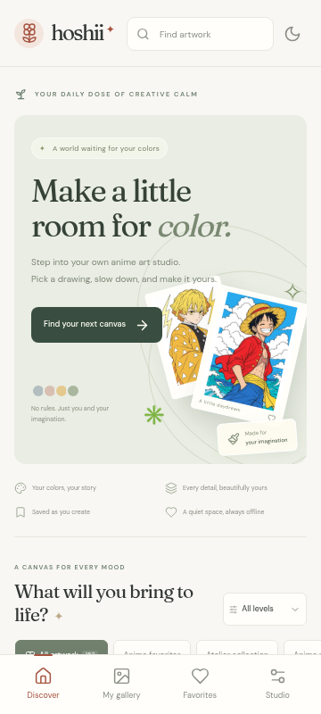
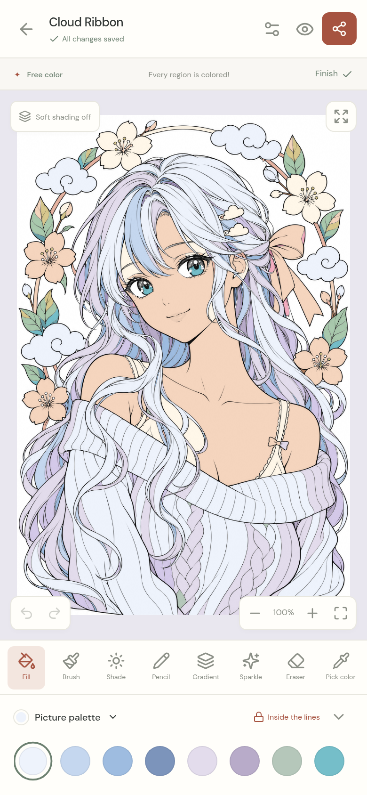
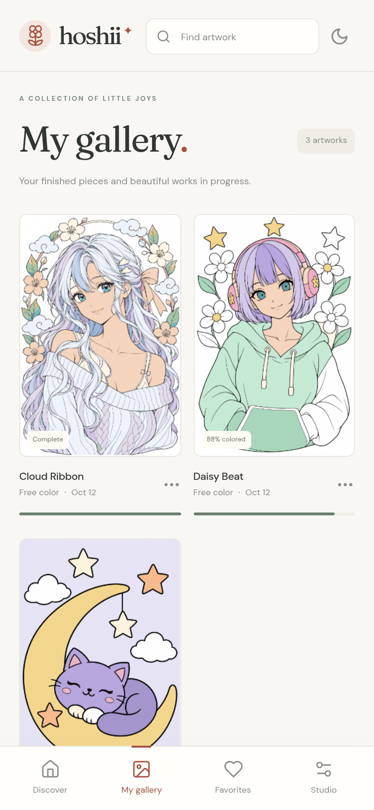
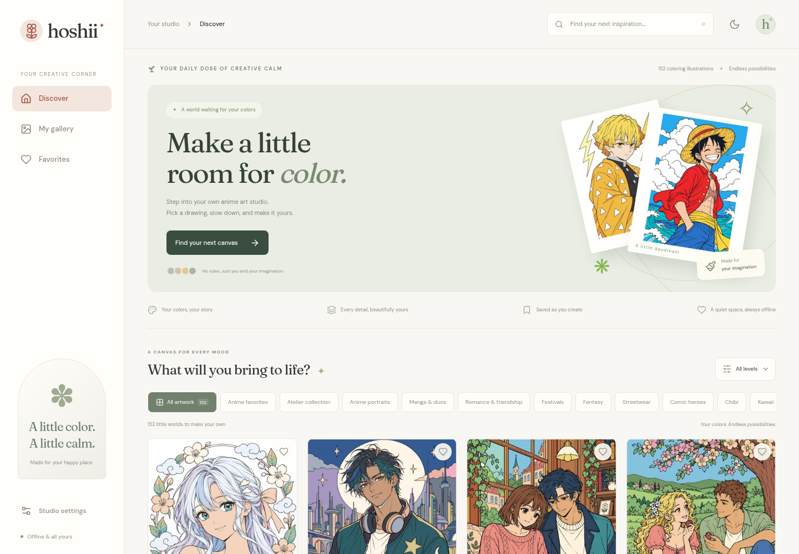

# Hoshii — Anime Coloring Studio

**A little color. A little calm.** An original, offline Android coloring app for anime portraits, manga companions, festivals, fantasy, streetwear, comic heroes, chibi characters and cozy kawaii worlds.

## Install the Android app

Download **[hoshii-1.1.0-debug.apk](delivery/hoshii-1.1.0-debug.apk)**, open it on an Android phone, and allow installation from your file manager when Android asks. Android 6.0+ and a current Android System WebView are supported. This is a signed **testing APK**, not a Play Store release. The [SHA256 checksum](delivery/hoshii-1.1.0-debug.apk.sha256) accompanies the APK.

The app bundles all artwork and fonts. No account, advertising, payment, tracking, or connection is required. Your editable coloring stays on the device. Export important artwork before uninstalling or clearing app data.

## What is included

- **152 individually usable coloring pages**, across all ten categories, with different subjects, outfits, props and compositions. Easy, Medium and Hard reflect visible region counts and detail sizes.
- **31 individually image-generated PNG illustrations** in the Atelier collection, including the **20-page New Horizons expansion**: two new compositions in each category. Original 1024 × 1536 PNG masters, aligned PNG color references and lightweight previews are kept in the project.
- **20 Anime favorites fan-art pages**: four characters each from Naruto, One Piece, Dragon Ball Z, Demon Slayer and Jujutsu Kaisen. Choose **Anime favorites** in Discover, or search by character or series. [See all twenty](docs/ANIME_FAVORITES.md).
- Stable closed fill regions, suggested palettes and full-resolution immutable PNG ink preserve detailed hair, eyelashes and clothing. Earlier vector pages retain their original assets, IDs, and optional aligned shading.
- **Free Color**, **Color by Number**, and **Paint & Shade**. Numbered regions include remaining counts and hints.
- Tap fill, smooth pressure-sensitive brush, soft airbrush, pencil, diagonal gradient fill, sparkle brush, eraser and eyedropper. Brush size/opacity, per-stroke region locking, and unrestricted painting are available in tool settings.
- Undo/redo; pinch zoom up to 20×; two-finger panning; fit and full-screen controls; collapsible palette; phone portrait/landscape and tablet layouts.
- Coordinated skin, hair, eyes, pastel, festival, sunset, neon, comic and manga palettes; native full color picker; HEX input; recent shades; saved swatches and named custom palettes.
- Autosave after every completed fill or stroke. Editable projects and thumbnails use separate IndexedDB stores. Restore, rename, duplicate, favorite, start fresh, and confirmed deletion.
- **High-resolution PNG/JPEG export** (3000 × 3900 for vector pages; 2731 × 4096 for PNG pages) through Android’s share sheet. Transparent PNG for standalone character pages. Exports use final model state independently of fill animation.
- Light, dark and system themes; reduced-motion support; bundled fonts; original launcher icon and splash.

The main flow is **Discover → choose a drawing and mode → color → save/share**. My gallery keeps unfinished pieces alongside completed ones.

## The Atelier PNG collection

[Download all 31 line-art and aligned color-reference PNG pairs](delivery/hoshii-atelier-pngs.zip). The archive preserves the native 1024 × 1536 resolution. Image-generated color guides and exact prompts are retained separately in `assets/source/`. In the app, choose **Atelier collection**, or search **new horizons** to see the 20 New Horizons drawings. See [the expansion catalog and validation notes](docs/NEW_HORIZONS.md).

## Anime favorites

[Download all 20 anime character line-art and aligned color-reference PNG pairs](delivery/hoshii-anime-favorites-pngs.zip). Naruto, Sasuke, Sakura, Kakashi; Luffy, Zoro, Nami, Chopper; Goku, Vegeta, Gohan, Piccolo; Tanjiro, Nezuko, Zenitsu, Inosuke; and Yuji, Gojo, Megumi, Nobara each have their own native 1024 × 1536 drawing. The app includes a dedicated **Anime favorites** collection filter and searchable franchise tags. These are newly generated fan-art compositions of the named characters. [Art catalog and review notes](docs/ANIME_FAVORITES.md).

The checked-in Android 1.1.0 APK predates New Horizons and Anime favorites. Rebuild it with `npm run android:build` to include the expanded library; the source and web build include all 152 pages.

## Screenshots

| Discover | Coloring studio | My gallery |
|---|---|---|
|  |  |  |



## Run and build

Node.js 22+ and npm are required. All runtime dependencies are locked in `package-lock.json`.

```sh
npm ci
npm run dev
```

The development server runs on port 5173. The production web application is generated with:

```sh
npm run build
npm run preview
```

For Android, install a full JDK 21, Android SDK 35 and Build Tools 35.0.0, then:

```sh
npm run android:build
```

This rebuilds the web app, synchronizes bundled assets, builds the native shell, and copies the signed debug APK and checksum to `delivery/`. [Android setup and signing instructions](docs/ANDROID_BUILD.md) include verified cloud bootstrap helpers. Do not commit private release keys. Keep the app ID and signing key unchanged to retain local artwork during updates; increment version codes for production updates.

## Checks

```sh
npm test                    # 26 storage, export and engine unit checks
npm run test:canvas         # Real Chromium pixel and multitouch checks
npm run test:e2e            # Full app workflows, mobile layout and downloads
node scripts/validate-library.mjs  # All regions and exact PNG/reference alignment
node scripts/validate-png-canvas.mjs # Actual PNG gradients and clipped brush boundaries
npm run build
npm run android:build
```

Browser checks use `/usr/bin/chromium`, or `CHROMIUM_PATH` when specified. Install Chromium locally or use `npx playwright install chromium` and point `CHROMIUM_PATH` to its executable. Tests never replace real rendering with trivial canvas mocks. See [the delivery check report](docs/VALIDATION.md) for results and physical-device checks still needed.

## Add artwork without breaking saved projects

Read [the artwork pipeline](docs/ARTWORK_PIPELINE.md) and [the PNG collection guide](docs/PNG_COLLECTION.md). Original PNGs and prompts are under `assets/source/`; `assets/source/new-collection.json` defines the expandable collection. Published assets live in `public/art/`. Add a new manifest entry under a new stable ID, compile, review, validate, and rebuild. Ordinary app builds use the checked-in assets and require no image-generation service or Python.

```sh
npm run art
node scripts/validate-library.mjs
npm run build
```

Art and region IDs are permanent save-data keys. Add new pages under new IDs; retain existing geometry and IDs. A revised composition gets a new ID while its earlier version remains available to existing saves. No asset is fetched from the network at runtime. The catalog is lightweight, thumbnails load lazily, and only a few detailed pages are cached at a time.

## Architecture and future features

React + TypeScript + Vite provide the interface. Canvas2D/Path2D render editable fill regions and strokes underneath the preserved PNG ink or original vector linework. PNG images are decoded before opening a canvas and retained in a bounded cache. Capacitor 7 packages the app and integrates Android back handling, lifecycle, status bars, private-cache file export and sharing.

| Location | Responsibility |
|---|---|
| `src/App.tsx`, `src/styles.css` | Discover, gallery, palettes, studio controls, save orchestration |
| `src/components/PaintCanvas.tsx` | Painting/navigation gestures and presentation animation |
| `src/engine/render.ts` | Hit testing, clipped paint layers, pressure, shading and export |
| `src/lib/storage.ts` | Validated, versioned local persistence and migration |
| `src/lib/export.ts` | Native share and browser download adapters |
| `src/types.ts` | Stable artwork, project and stroke contracts |
| `scripts/art/`, `scripts/build-art.mjs` | Original source artwork and deterministic library compiler |
| `scripts/build-png-art.py`, `assets/source/new-collection.json` | PNG boundary extraction, stable region IDs, curated references and diagnostics |
| `android/` | Native Android shell and packaging |

Ads and a currency/premium library are deliberately future work. Add an entitlement service keyed by immutable artwork IDs, with a separate wallet ledger and platform billing/rewarded-ad adapters. Keep painting and storage independent of those services. Do not gate existing offline projects or add tracking without a deliberate product/privacy decision. This version contains no payment or ad SDKs.

The earlier 100-page collection uses stylized vector artwork, with one additional generated collectible. The Atelier collection combines its first eleven generated PNG drawings with 20 New Horizons illustrations. Anime favorites adds 20 separate character fan-art PNG pages. Native PNG detail is retained rather than replaced with simplified vector artwork. Generated color guides supply palette hints; published references use the exact same fill geometry and ink as the editor. Free brushes and gradients add your own lighting. See the artwork documentation for source resolution, review results and conversion details.
