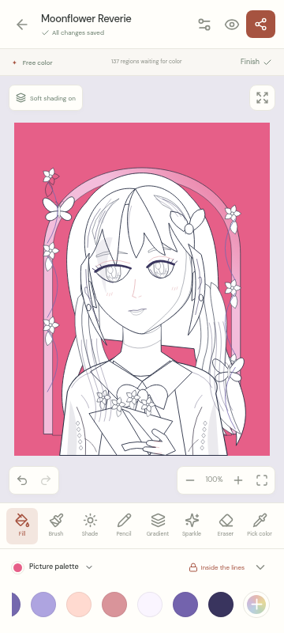

# Hoshii — Anime Coloring Studio

**A little color. A little calm.** An original, offline Android coloring app for anime portraits, manga companions, festivals, fantasy, streetwear, comic heroes, chibi characters and cozy kawaii worlds.

## Install the Android app

Download **[hoshii-1.0.0-debug.apk](delivery/hoshii-1.0.0-debug.apk)**, open it on an Android phone, and allow installation from your file manager when Android asks. Android 6.0+ and a current Android System WebView are supported. This is a signed **testing APK**, not a Play Store release. The [SHA256 checksum](delivery/hoshii-1.0.0-debug.apk.sha256) accompanies the APK.

The app bundles all artwork and fonts. No account, advertising, payment, tracking, or connection is required. Your editable coloring stays on the device. Export important artwork before uninstalling or clearing app data.

## What is included

- **101 original, individually usable vector coloring pages**, across all ten requested categories, with genuinely different subjects, outfits, props and compositions. Easy, Medium and Hard reflect visible region counts and detail sizes.
- Crisp closed paths, stable fill-region IDs, suggested palettes, aligned soft shading, finished-color references, line-art SVGs and lightweight WebP thumbnails.
- **Free Color**, **Color by Number**, and **Paint & Shade**. Numbered regions include remaining counts and hints.
- Tap fill, smooth pressure-sensitive brush, soft airbrush, pencil, diagonal gradient fill, sparkle brush, eraser and eyedropper. Brush size/opacity, per-stroke region locking, and unrestricted painting are available in tool settings.
- Undo/redo; pinch zoom up to 20×; two-finger panning; fit and full-screen controls; collapsible palette; phone portrait/landscape and tablet layouts.
- Coordinated skin, hair, eyes, pastel, festival, sunset, neon, comic and manga palettes; native full color picker; HEX input; recent shades; saved swatches and named custom palettes.
- Autosave after every completed fill or stroke. Editable projects and thumbnails use separate IndexedDB stores. Restore, rename, duplicate, favorite, start fresh, and confirmed deletion.
- **3000 × 3900 PNG/JPEG export** through Android’s share sheet. Transparent PNG for standalone character pages. Exports use final model state independently of fill animation.
- Light, dark and system themes; reduced-motion support; bundled fonts; original launcher icon and splash.

The main flow is **Discover → choose a drawing and mode → color → save/share**. My gallery keeps unfinished pieces alongside completed ones.

## Screenshots

| Discover | Coloring studio | My gallery |
|---|---|---|
|  |  |  |


## Run and build

Node.js 22+ and npm are required. All runtime dependencies are locked in `package-lock.json`.

```sh
npm ci
npm run dev
```

The development server runs on port 5173. The production web application is generated with:

```sh
npm run build
npm run preview
```

For Android, install a full JDK 21, Android SDK 35 and Build Tools 35.0.0, then:

```sh
npm run android:build
```

This rebuilds the web app, synchronizes bundled assets, builds the native shell, and copies the signed debug APK and checksum to `delivery/`. [Android setup and signing instructions](docs/ANDROID_BUILD.md) include verified cloud bootstrap helpers. Do not commit private release keys. Keep the app ID and signing key unchanged to retain local artwork during updates; increment version codes for production updates.

## Checks

```sh
npm test                    # 26 storage, export and engine unit checks
npm run test:canvas         # Real Chromium pixel and multitouch checks
npm run test:e2e            # Full app workflows, mobile layout and downloads
node scripts/validate-library.mjs  # Every visible label, completion and reference alignment
npm run build
npm run android:build
```

Browser checks use `/usr/bin/chromium`, or `CHROMIUM_PATH` when specified. Install Chromium locally or use `npx playwright install chromium` and point `CHROMIUM_PATH` to its executable. Tests never replace real rendering with trivial canvas mocks. See [the delivery check report](docs/VALIDATION.md) for results and physical-device checks still needed.

## Add artwork without breaking saved projects

Read [the artwork pipeline](docs/ARTWORK_PIPELINE.md). Generator source is under `scripts/art/`; published library assets live in `public/art/`.

```sh
npm run art
node scripts/validate-library.mjs
npm run build
```

Art and region IDs are permanent save-data keys. Add new pages under new IDs; retain existing geometry and IDs. A revised composition gets a new ID while its earlier version remains available to existing saves. No asset is fetched from the network at runtime. The catalog is lightweight, thumbnails load lazily, and only a few detailed pages are cached at a time.

## Architecture and future features

React + TypeScript + Vite provide the interface. Canvas2D/Path2D render editable vector regions and strokes. Capacitor 7 packages the app and integrates Android back handling, lifecycle, status bars, private-cache file export and sharing.

| Location | Responsibility |
|---|---|
| `src/App.tsx`, `src/styles.css` | Discover, gallery, palettes, studio controls, save orchestration |
| `src/components/PaintCanvas.tsx` | Painting/navigation gestures and presentation animation |
| `src/engine/render.ts` | Hit testing, clipped paint layers, pressure, shading and export |
| `src/lib/storage.ts` | Validated, versioned local persistence and migration |
| `src/lib/export.ts` | Native share and browser download adapters |
| `src/types.ts` | Stable artwork, project and stroke contracts |
| `scripts/art/`, `scripts/build-art.mjs` | Original source artwork and deterministic asset compiler |
| `android/` | Native Android shell and packaging |

Ads and a currency/premium library are deliberately future work. Add an entitlement service keyed by immutable artwork IDs, with a separate wallet ledger and platform billing/rewarded-ad adapters. Keep painting and storage independent of those services. Do not gate existing offline projects or add tracking without a deliberate product/privacy decision. This version contains no payment or ad SDKs.

The main 100-page library has a consistent, stylized vector look; an additional
generated collectible illustration offers finer detail. It is not a reproduction of the supplied painterly references. See the artwork documentation for the exact production and review process, sources and limitations.
