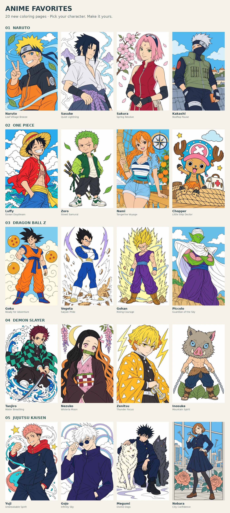

# Anime favorites — 20 character coloring pages

The library expands from **132 to 152 pages**, adding four characters from each of five popular anime series. Choose **Anime favorites** in Discover, or search a character or series name. Common aliases such as `dbz`, `jjk`, and `kimetsu no yaiba` also work. Luffy and Zenitsu appear in the Discover banner.



These are newly generated fan-art compositions of the named franchise characters. The earlier 132 catalog entries, published assets and saved-project geometry are preserved. Each new page has a native **1024 × 1536** PNG line-art master, a generated color guide, source prompts/review notes, stable interactive fill regions, aligned finished-color reference and lightweight thumbnail. No drawing was upscaled or extracted from a contact sheet.

## Catalog

| Drawing | Series | Level | Fill regions |
|---|---|---|---|
| Naruto — Leaf Village Breeze | Naruto | Hard | 145 |
| Sasuke — Quiet Lightning | Naruto | Medium | 142 |
| Sakura — Spring Resolve | Naruto | Hard | 221 |
| Kakashi — Rooftop Pause | Naruto | Hard | 298 |
| Luffy — Ocean Daydream | One Piece | Hard | 177 |
| Zoro — Street Samurai | One Piece | Hard | 324 |
| Nami — Tangerine Voyage | One Piece | Hard | 579 |
| Chopper — Little Ship Doctor | One Piece | Hard | 204 |
| Goku — Ready for Adventure | Dragon Ball Z | Medium | 114 |
| Vegeta — Saiyan Pride | Dragon Ball Z | Hard | 182 |
| Gohan — Rising Courage | Dragon Ball Z | Hard | 165 |
| Piccolo — Guardian of the Sky | Dragon Ball Z | Hard | 251 |
| Tanjiro — Water Breathing | Demon Slayer | Hard | 369 |
| Nezuko — Wisteria Moon | Demon Slayer | Hard | 319 |
| Zenitsu — Thunder Focus | Demon Slayer | Medium | 160 |
| Inosuke — Mountain Spirit | Demon Slayer | Hard | 140 |
| Yuji — Unbreakable Spirit | Jujutsu Kaisen | Medium | 73 |
| Gojo — Infinity Sky | Jujutsu Kaisen | Hard | 132 |
| Megumi — Divine Dogs | Jujutsu Kaisen | Hard | 144 |
| Nobara — City Confidence | Jujutsu Kaisen | Hard | 593 |

The expansion adds **4,732 fill regions**, with 4 Medium and 16 Hard pages. Difficulty uses measured region counts and small-region density, including fine costume patterns and sword-hilt details. The earlier Easy pages remain available.

## Source and boundary review

All twenty source drawings and guides were inspected, followed by the compiled references. Reviews cover recognizable hair and costumes, faces/eyes, hands, props, silhouette separation and framing. Individual records are beside each master in `assets/source/anime-<character>.md`.

- Luffy, Chopper, Gohan, Megumi and Nobara received generated line-continuity refinements. Accepted masters are retained unchanged. Their guides were made from the same compositions before refinement and are used only for palette hints.
- Kakashi, Nami, Goku and Vegeta use the existing explicit one-pixel closure option. The manifest records each setting; reports count every added ink pixel.
- Goku has one short three-pixel-wide visible contour connection at the upper cloud/shoulder junction. Its exact normalized coordinates are retained in the manifest.
- Semantic color probes check hair/skin, eye whites, costume panels and important background boundaries. All twenty have zero conflicting or rejected probes.
- Final references are rebuilt from the accepted masks and original PNG ink. Guide gradients and unbounded color transitions become solid region colors; the generated guide is never substituted for the aligned app reference.

Existing artwork IDs and geometry remain unchanged. New source and geometry hashes are appended to `assets/source/new-collection.lock.json`.

## Verification

- Production TypeScript/Vite build passes.
- All 26 unit tests, 4 PNG pipeline tests, and 21 browser workflow tests pass. Browser coverage includes collection/series/name discovery, plus fill, undo/redo, save/restore and full-resolution export for a character from every franchise.
- All 39 Canvas2D/PNG/touch checks pass. The full 51-page PNG collection passes 204 gradient/brush boundary checks with no neighboring-region leaks.
- Full-library validation passes for 152 pages and 36,839 regions, including exact PNG ink/reference alignment and tappable labels. All twenty new sources have zero conflicting or rejected semantic probes.
- The earlier 132 catalog entries, 559 published asset files and 31 PNG geometry locks are unchanged. The original Atelier download archive is also unchanged.
- The download contains 20 native PNG pairs. Archive integrity, SHA256 and decoded pixel equality against the published app assets pass; the ZIP is 42,203,703 bytes.

[Desktop collection preview](screenshots/anime-favorites-desktop.png) · [Mobile collection preview](screenshots/anime-favorites-mobile.png)

## Download and reproduction

[Download the 20 native line-art/reference PNG pairs](../delivery/hoshii-anime-favorites-pngs.zip) and [SHA256 checksum](../delivery/hoshii-anime-favorites-pngs.zip.sha256). The original [31-page Atelier archive](../delivery/hoshii-atelier-pngs.zip) is preserved separately. The packager verifies lossless decoded PNG pixels and refuses archives at or above GitHub’s 100 MiB file limit.

Follow [the PNG pipeline](PNG_COLLECTION.md) with its pinned Python dependencies and Chromium. Compile only new IDs when authoring; lock accepted geometry after review:

```sh
python scripts/build-png-art.py --only anime-luffy --lock
npm run art
node scripts/validate-library.mjs
node scripts/validate-png-canvas.mjs
npm run build
python scripts/package-png-art.py --collection anime-favorites
```

The checked-in Android 1.1.0 APK predates both New Horizons and Anime favorites. Rebuild it using [the Android instructions](ANDROID_BUILD.md) to bundle all 152 pages. This artwork expansion does not replace that APK.
