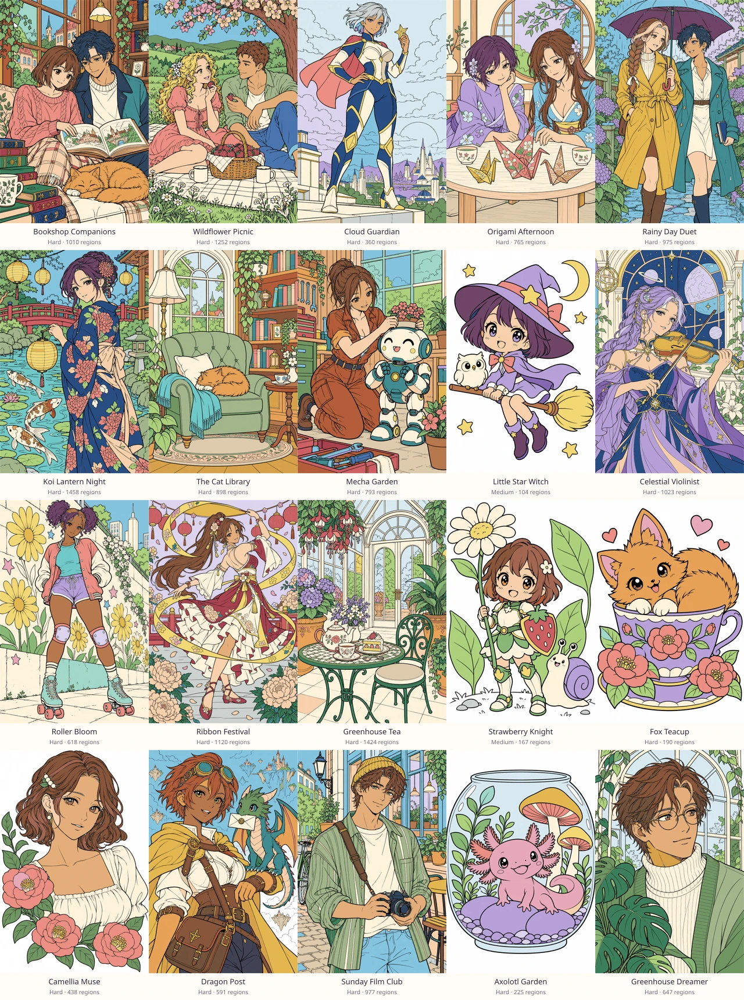

# New Horizons — 20 new drawings

The library expands from **112 to 132 drawings**, with two new compositions in each of the ten categories. All 112 earlier catalog entries and their published assets remain byte-for-byte unchanged. The original eleven PNG source/geometry locks are preserved.

Choose **Atelier collection** in the app, or search **new horizons** to show exactly these twenty additions.



Every new page has an individual native **1024 × 1536** line-art master, a separately generated color guide, a retained prompt/review record, stable fill regions, fixed PNG ink, aligned finished-color reference and lightweight WebP thumbnail. The color guides suggest palette choices; they never supply the final reference geometry. No source images were upscaled or cropped from contact sheets.

## Catalog

| Drawing | Category | Level | Fill regions |
|---|---|---|---|
| Celestial Violinist | Fantasy | Hard | 1023 |
| Camellia Muse | Anime portraits | Hard | 438 |
| Greenhouse Dreamer | Anime portraits | Hard | 647 |
| Bookshop Companions | Manga & duos | Hard | 1010 |
| Origami Afternoon | Manga & duos | Hard | 765 |
| Wildflower Picnic | Romance & friendship | Hard | 1252 |
| Rainy Day Duet | Romance & friendship | Hard | 975 |
| Koi Lantern Night | Festivals | Hard | 1458 |
| Ribbon Festival | Festivals | Hard | 1120 |
| Dragon Post | Fantasy | Hard | 591 |
| Roller Bloom | Streetwear | Hard | 618 |
| Sunday Film Club | Streetwear | Hard | 977 |
| Cloud Guardian | Comic heroes | Hard | 360 |
| Mecha Garden | Comic heroes | Hard | 793 |
| Little Star Witch | Chibi | Medium | 104 |
| Strawberry Knight | Chibi | Medium | 167 |
| Fox Teacup | Kawaii | Hard | 190 |
| Axolotl Garden | Kawaii | Hard | 225 |
| The Cat Library | Cozy scenes | Hard | 898 |
| Greenhouse Tea | Cozy scenes | Hard | 1424 |

The expansion adds **15,035 independently reachable fill regions**. Difficulty follows measured region count and small-region density: two Medium and eighteen Hard pages. The original Easy collection remains available.

## Reviewed boundaries and compatibility

- Wildflower Picnic and Koi Lantern Night explicitly use the existing `closeGaps: 1` option to close faint hair/face boundary breaks. Their diagnostic reports record the added boundary pixels; the source masters remain unchanged.
- Axolotl Garden has three short, visible contour repairs between the left gills and face. Exact coordinates and widths are in the manifest.
- All semantic palette probes are retained and pass with no conflicts or rejected seeds. New source and geometry hashes are recorded in `assets/source/new-collection.lock.json`.
- The painting engine, storage format, earlier page IDs and earlier region geometry are unchanged. New and existing projects pass save/restore and export checks.

## Verification

- Production build and TypeScript: passed.
- Unit suite: 26 passed.
- Chromium engine checks: 20 canvas, 13 PNG and 6 touch checks passed.
- PNG compiler suite: 4 passed.
- Browser workflows: all 15 passed, including finding all 20 additions and exercising fill, undo/redo, restore and full-resolution PNG export on Celestial Violinist, Little Star Witch and Axolotl Garden.
- Full-library validation: all 132 pages and 32,107 region anchors passed; every page reaches completion. All 31 PNG references and blank line-art images match the engine at native resolution.
- PNG brush/gradient validation: all 124 boundary checks passed across 31 pages.

The PNG export assertion accounts for retained source ink over the chosen fill. It still checks the exported dimensions and sampled final-color pixel; faint original paper texture is not mistaken for a missing or misaligned fill.

## Sources and reproduction

`assets/source/new-collection.json` lists the pages under the `new horizons` tag. Each `assets/source/atelier-<name>.md` retains the exact source and color-guide prompts and review notes. Reports and numbered region maps are in `docs/png-art/`.

Use the pinned Python artwork requirements and Chromium described in [the PNG pipeline](PNG_COLLECTION.md). Compile only the IDs being prepared, then publish their aligned references:

```sh
/workspace/.venv-art/bin/python scripts/build-png-art.py --only <artwork-id> --lock
npm run art
node scripts/validate-library.mjs
node scripts/validate-png-canvas.mjs
npm run build
/workspace/.venv-art/bin/python scripts/package-png-art.py
```

The [download archive](../delivery/hoshii-atelier-pngs.zip) includes all 31 native PNG pairs. Its PNG copies are recompressed losslessly for download; the packager verifies decoded RGBA pixels before writing each image. Published application assets and source masters are not recompressed by packaging.

The checked-in Android 1.1.0 APK predates this expansion. Native packaging was not run in this web development environment; rebuild the APK using [the Android build instructions](ANDROID_BUILD.md) to bundle the new library.
